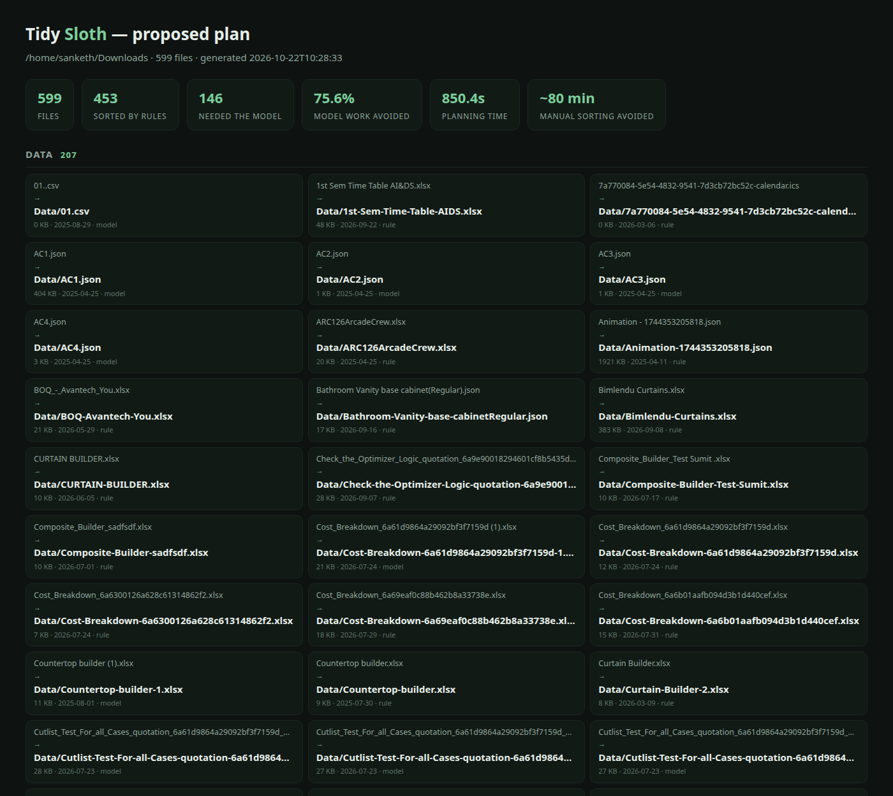

# 🦥 Tidy Sloth

**A local-first file tidier that conserves energy.**

Your Downloads folder is 599 files deep and you keep closing the tab. Tidy
Sloth does the thing you keep putting off — sorts the pile into folders and
gives the files names a human can read.

The sloth part is not decoration. Cheap deterministic rules handle the files
that are obvious; a **local open-weight model** is only woken for the ones
that genuinely need judgement. On a real 599-file Downloads folder that meant
**75.6% of files never touched the model**, which is why it finished in
minutes rather than hours.

```bash
python3 tidysloth.py scan  ~/Downloads     # what is in here? (read-only)
python3 tidysloth.py plan  ~/Downloads     # propose moves, write a report
python3 tidysloth.py apply ~/Downloads/.tidysloth/plan.json
python3 tidysloth.py undo  ~/Downloads/.tidysloth/manifest-*.json
```

## What makes it safe

Sorting files is a destructive-looking operation, so the defaults are boring:

- **Never deletes anything.** There is no delete code path.
- **`plan` changes nothing.** It writes `plan.json` and a `report.html` you can
  read in the browser before committing.
- **Collisions are renamed, never overwritten.**
- **Every move is logged** to a timestamped manifest; `undo` replays it in
  reverse and removes the empty folders it created.
- **Hidden files, symlinks and the tool's own state directory are skipped.**

## How the sloth saves energy

```
file ──▶ rules ──▶ confident? ──yes──▶ done, 0 tokens
                        │
                        no
                        ▼
                 local model (batched)  ──▶ category + name
                        │
                        ▼
              Python validates, then moves
```

1. **Extension rules** (`png → Images`, `xlsx → Data`, `zip → Archives`) cover
   most of any folder, instantly and for free.
2. **Purpose rules** beat extension: `Invoice-March.pdf` goes to `Invoices`, not
   `Documents`; `Resume-Sanketh.pdf` goes to `Resumes`.
3. **A meaningful filename is enough.** `carprices.csv` needs no model to know
   it belongs in `Data`.
4. Only the leftovers — `img.png`, `1762857107887_floop.png`, `AC3.json` — go
   to the model, in batches.

Measured on a real 599-file folder:

| | |
|---|---|
| files | 599 |
| resolved by rules | 453 (75.6%) |
| needed the model | 146 |
| model calls | 13 (batches of 12) |
| wall time | 14.2 min |
| estimated manual sorting | ~80 min |

`plan` also writes a report you can read in the browser — every proposed move,
grouped by destination folder, before anything touches the disk:



## Model safety rails

Small local models are not trustworthy editors, so the model's output is
treated as a suggestion:

- The category must be exactly one of the 15 known strings, or it is ignored.
- Answers are matched **positionally**, and only if the model returned one
  entry per file. A model-supplied index is never trusted — that is how names
  leak across rows (`AC2.json.pdf`).
- Proposed names are stripped of any echoed extension (`SoulTree.pdf` →
  `SoulTree`), so you never get `thing.pdf.pdf`.
- **A rename may only reuse the file's own words.** This is the important one.
  A 1B model batching 25 filenames will cheerfully attach one row's name to
  another row's file — I saw `SoulTree-Brochure.pdf` come back as `AC2.pdf`.
  So a proposal is accepted only if it shares a token with the original
  filename (or is a re-spacing of it). The model may reorganise a name; it may
  never import one from somewhere else in the batch.
- **A name with no meaning is never given invented meaning.** `01.csv` stays
  `01.csv`; the model is not allowed to rename a pile of digits into
  "project-proposal" just because it sounds plausible.
- Extensions are never changed by the model.

## Install

Python 3.10+ and [Ollama](https://ollama.com). No pip install, no build step.

```bash
ollama pull llama3.2:1b
python3 tidysloth.py scan ~/Downloads
```

Use a bigger model for better naming:

```bash
MODEL=llama3.1:8b python3 tidysloth.py plan ~/Downloads
```

Zero-model mode still produces a complete, useful plan:

```bash
python3 tidysloth.py plan ~/Downloads --no-model
```

## Configuration

| Env | Default | Meaning |
|---|---|---|
| `MODEL` | `llama3.2:1b` | Ollama model for ambiguous files |
| `OLLAMA` | `http://127.0.0.1:11434` | local Ollama base URL |

Flags: `--limit N`, `--batch N` (files per model call, default 20),
`--no-model`.

## Honest notes

- The ~80 minute figure assumes 8 seconds per file to open, judge, rename and
  drag — conservative, but it is an estimate, not a measurement.
- 11 minutes is on a CPU-only laptop with a 1B model. Most of that is the
  model, not the rules.
- Categories are opinionated (15 folders). Edit `CATEGORIES` and `EXT_RULES`
  at the top of `tidysloth.py` — it is one file.
- Nothing leaves the machine. There is no API key and no remote endpoint; you
  can verify by unplugging the network and watching it still work.

## License

MIT — see [LICENSE](LICENSE).
